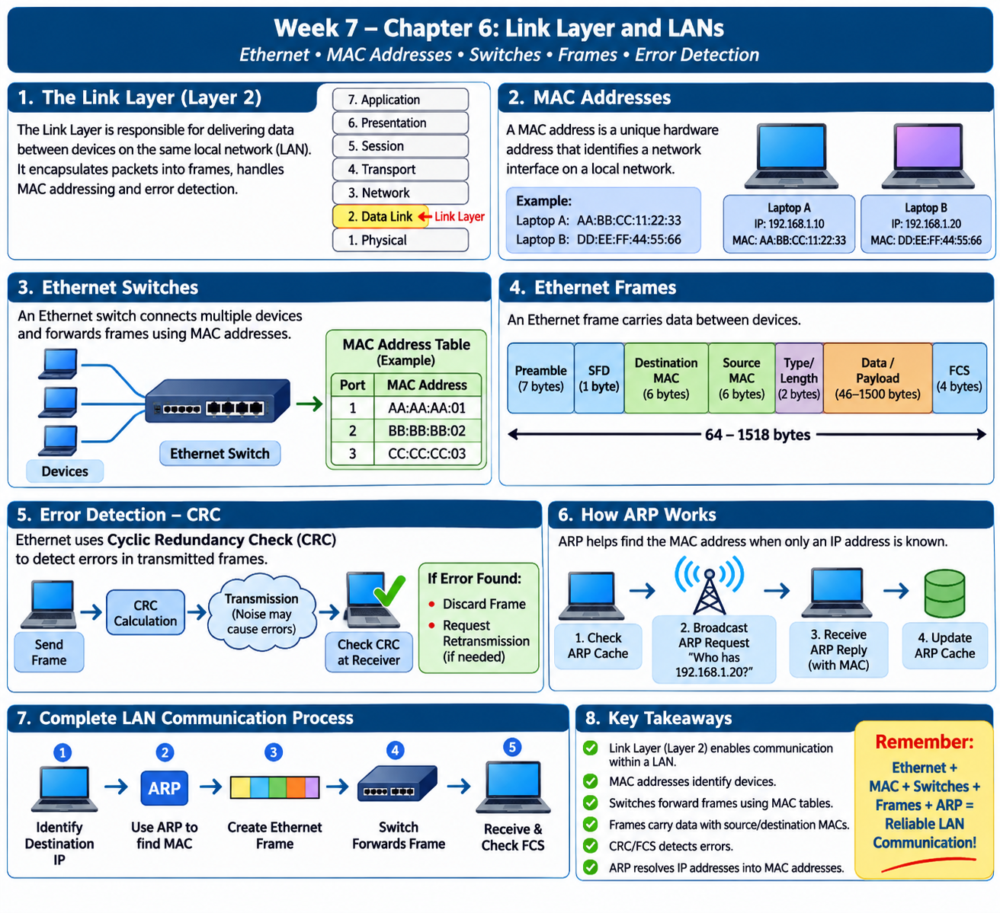

# 6. Ethernet Switches

An Ethernet switch is a networking device that connects multiple computers, printers, servers, and other devices within a Local Area Network (LAN).

A switch operates primarily at Layer 2 (Data Link Layer) of the OSI model. It forwards Ethernet frames using destination MAC addresses.

### How Does an Ethernet Switch Work?

A switch uses a MAC Address Table (also called a forwarding table) to keep track of which devices are connected to its ports.

The process works as follows:

1. **MAC Learning:** The switch examines the source MAC address of every incoming frame.
2. **MAC Table Update:** It records the source MAC address and the port where the frame arrived.
3. **MAC Address Lookup:** The switch checks the destination MAC address against its MAC address table.
4. **Frame Forwarding:** If the destination MAC address is known, the switch forwards the frame through the appropriate port.
5. **Flooding:** If the destination MAC address is unknown, the switch floods the frame through all relevant ports except the incoming port.

### Practical Example

Imagine an office with three computers connected to an Ethernet switch.

| Switch Port | Connected Device | MAC Address |
|---|---|---|
| Port 1 | Computer A | AA:AA:AA:AA:AA:01 |
| Port 2 | Computer B | BB:BB:BB:BB:BB:02 |
| Port 3 | Computer C | CC:CC:CC:CC:CC:03 |

If Computer A wants to send data to Computer B:

- The switch receives the frame through Port 1.
- It checks the destination MAC address.
- It finds Computer B's MAC address associated with Port 2.
- It forwards the frame through Port 2.

Computer C does not receive this unicast frame.

### Important Switch Terminology

- **MAC Learning:** Learning device MAC addresses from incoming frames.
- **Forwarding:** Sending frames through the correct switch port.
- **Flooding:** Sending frames through multiple relevant ports when the destination is unknown.
- **Filtering:** Preventing unnecessary forwarding through ports that do not need the frame.
- **Broadcasting:** Forwarding broadcast frames to all relevant ports within the same VLAN, except the incoming port.

### Why Are Switches Important?

- They reduce unnecessary network traffic.
- They improve LAN communication efficiency.
- They allow multiple devices to communicate.
- Each switch port provides a separate collision domain in full-duplex Ethernet.

---

# 7. Ethernet Frames

An Ethernet frame is the basic unit of data transmission at the Ethernet Link Layer.

When the Network Layer sends an IP packet, the Link Layer encapsulates that packet inside an Ethernet frame before transmitting it across the network.

An Ethernet frame contains several fields that help deliver data correctly.

### Structure of an Ethernet Frame

| Field | Purpose |
|---|---|
| Preamble | Helps the receiving device synchronize with the incoming frame. |
| Start Frame Delimiter (SFD) | Identifies the beginning of the frame. |
| Destination MAC Address | Identifies the receiving network interface. |
| Source MAC Address | Identifies the sending network interface. |
| Type/Length | Identifies the upper-layer protocol or payload length. |
| Data/Payload | Contains the encapsulated packet, such as an IP packet. |
| Frame Check Sequence (FCS) | Helps detect transmission errors using CRC. |

### Practical Example

Suppose Computer A sends a message to Computer B.

Computer A has:

- Source MAC: AA:BB:CC:11:22:33
- Destination MAC: DD:EE:FF:44:55:66
- Destination IP: 192.168.1.20

The Link Layer creates an Ethernet frame containing:

- Source MAC address: AA:BB:CC:11:22:33
- Destination MAC address: DD:EE:FF:44:55:66
- Payload: The IP packet containing the actual data
- FCS: Error-detection information

The switch examines the destination MAC address and forwards the frame toward Computer B.

### Important Facts About Ethernet Frames

- A standard Ethernet frame has a minimum size of 64 bytes and a maximum size of 1518 bytes, excluding the preamble and SFD.
- The Ethernet header contains source and destination MAC addresses.
- The payload carries data from the Network Layer.
- The FCS field is used for error detection.
- The switch forwards frames based on destination MAC addresses.

---

# 8. Error Detection in the Link Layer

During data transmission, errors can occur because of electrical interference, signal distortion, or other physical transmission problems.

The Link Layer uses error-detection techniques to identify whether a frame may have been corrupted during transmission.

One important technique used in Ethernet is **Cyclic Redundancy Check (CRC)**.

### What Is CRC?

CRC stands for Cyclic Redundancy Check.

It is an error-detection technique used to check whether the received data has changed during transmission.

Ethernet uses a 32-bit CRC value stored in the Frame Check Sequence (FCS) field.

### How Does CRC Work?

1. **Sender Creates CRC:** The sending device calculates a CRC value based on the frame contents.
2. **CRC Added to Frame:** The calculated value is placed in the FCS field.
3. **Frame Transmission:** The Ethernet frame travels across the network.
4. **Receiver Checks CRC:** The receiving device calculates its own CRC value using the received frame.
5. **Error Detection:** The receiver compares the calculated result with the received FCS.
6. **Frame Handling:** If an error is detected, the Ethernet receiver discards the corrupted frame.

### Practical Example

Imagine Computer A sends a file to Computer B.

During transmission, electrical interference changes some bits in the frame.

When Computer B receives the frame:

- It checks the FCS value.
- It detects that the frame has been corrupted.
- It discards the frame.

The Ethernet FCS detects errors, but standard Ethernet does not automatically retransmit the corrupted frame. Recovery may be handled by higher-layer protocols such as TCP.

### Common Error-Detection Techniques

| Technique | Explanation |
|---|---|
| Parity Check | Adds an extra bit to help detect certain bit errors. |
| Checksum | Calculates a value used to detect changes in transmitted data. |
| CRC | Uses mathematical calculations to detect errors in data. |

### Why Is Error Detection Important?

- Helps identify corrupted frames.
- Improves data transmission reliability.
- Prevents corrupted frames from being passed to upper layers as valid data.
- Helps network protocols determine when recovery may be necessary.

---

# 9. How Ethernet, Switches, Frames, and Error Detection Work Together

Consider a practical example of two computers communicating within an office LAN.

**Step 1: Address Identification**

Computer A identifies Computer B's destination IP address.

**Step 2: ARP Resolution**

Computer A uses ARP to discover Computer B's MAC address if it is not already available in its ARP cache.

**Step 3: Frame Creation**

The Link Layer encapsulates the IP packet into an Ethernet frame containing source and destination MAC addresses.

**Step 4: Switch Processing**

The Ethernet switch receives the frame and examines its destination MAC address.

**Step 5: Frame Forwarding**

The switch checks its MAC address table and forwards the frame through the appropriate port.

**Step 6: Error Detection**

Computer B checks the received frame's FCS to determine whether transmission errors have occurred.

**Step 7: Data Delivery**

If the frame passes the error check, Computer B processes the Ethernet frame and passes the encapsulated packet to the Network Layer.

## Chapter 6 – Visual Overview

The following infographic summarizes the major
concepts covered in this chapter.

### Final Summary

| Concept | Main Responsibility |
|---|---|
| Ethernet | Defines the frame format and communication rules for wired Ethernet. |
| MAC Address | Identifies network interfaces within a LAN. |
| Switch | Forwards frames using MAC address information. |
| Ethernet Frame | Carries data between devices over an Ethernet link. |
| ARP | Resolves IPv4 addresses into MAC addresses. |
| CRC/FCS | Detects errors in transmitted Ethernet frames. |

# 10. Review Questions

1. What is the primary responsibility of an Ethernet switch?
2. How does a switch learn MAC addresses?
3. What happens when a switch receives a frame with an unknown destination MAC address?
4. What are the major fields in an Ethernet frame?
5. What is the purpose of the Frame Check Sequence (FCS)?
6. What does CRC stand for?
7. Does Ethernet automatically retransmit corrupted frames?
8. How do switches, MAC addresses, and Ethernet frames work together in a LAN?
